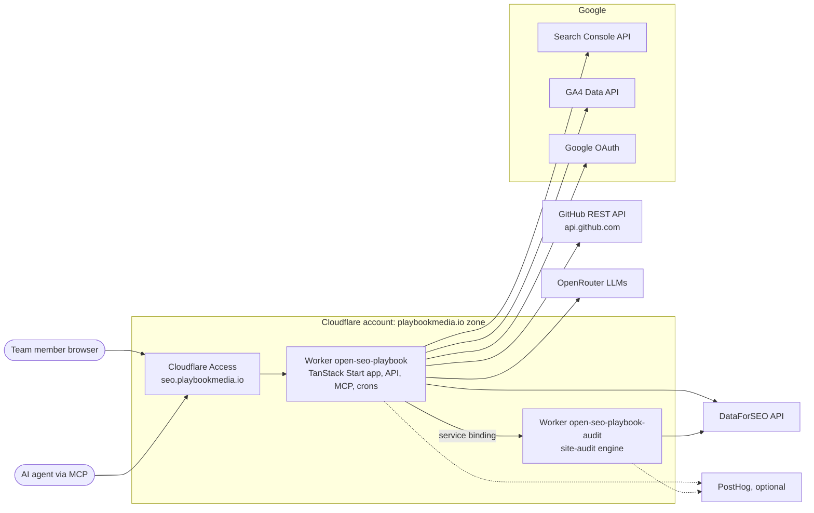
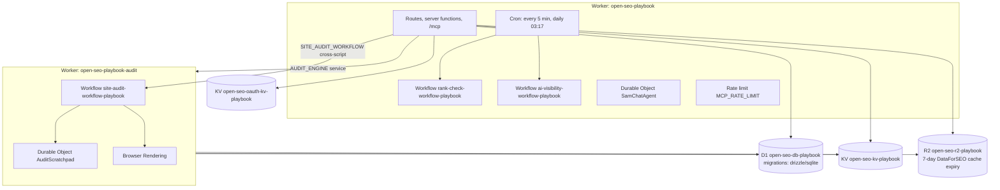
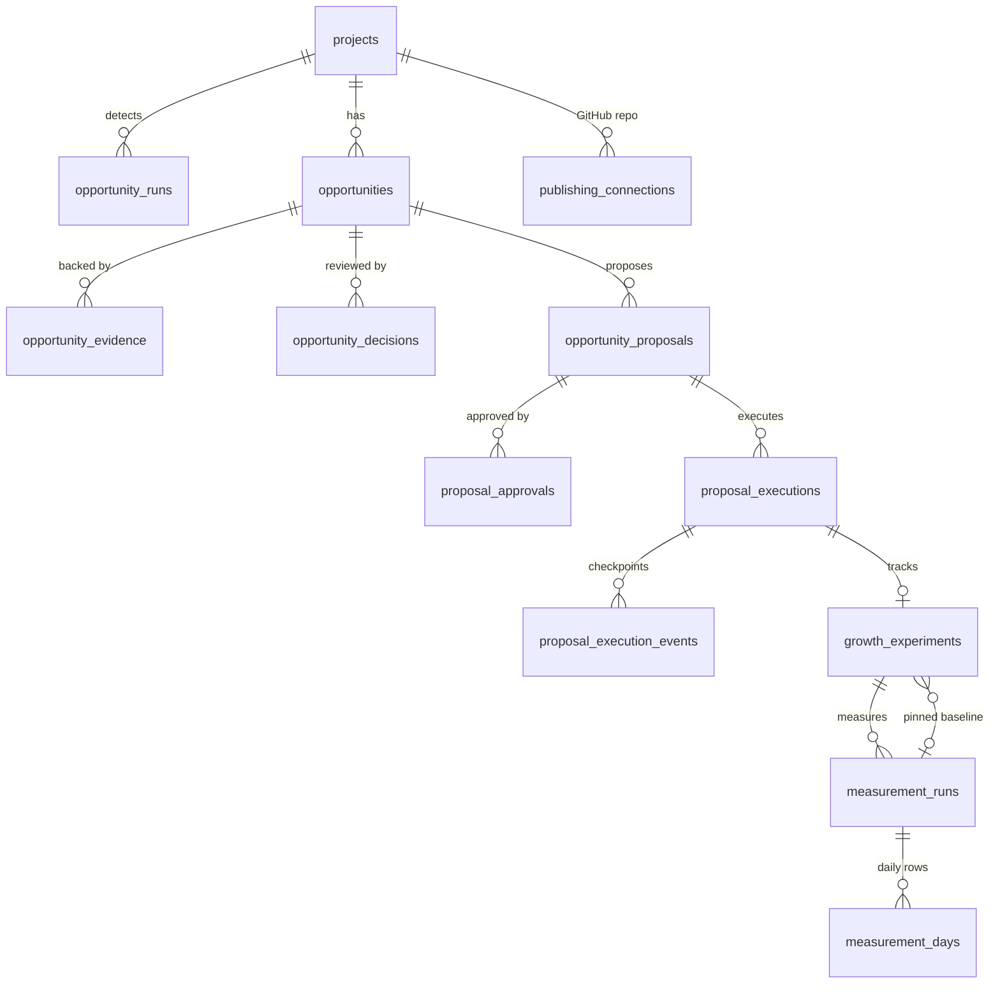
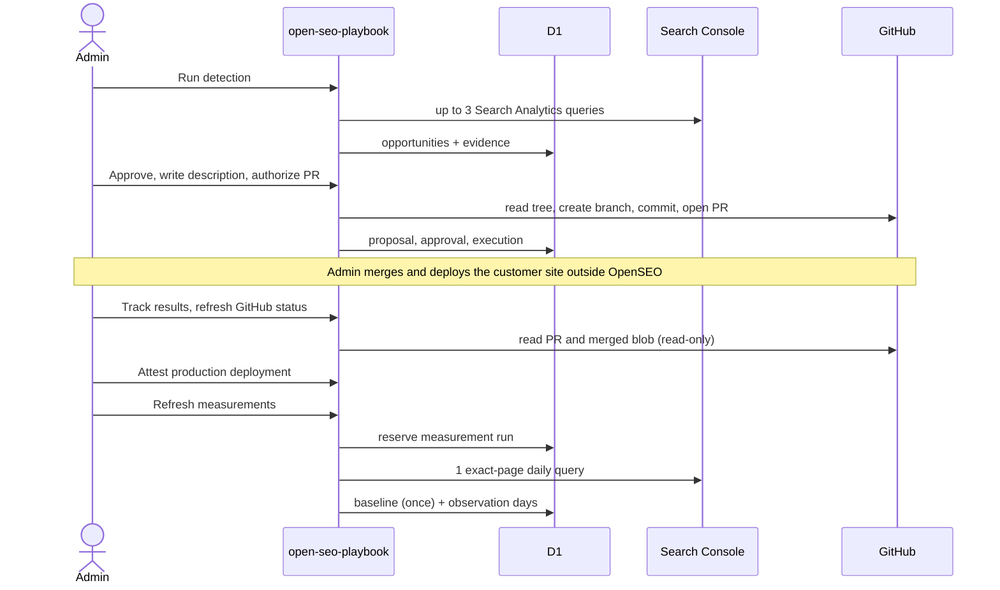
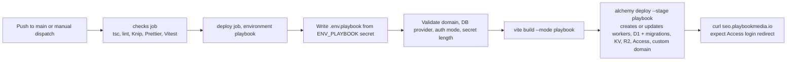

# Playbook Media deployment architecture

This note explains how the PlaybookMediaLLC fork of OpenSEO runs at `https://seo.playbookmedia.io`, what it depends on, and how it gets deployed. It is for engineers who maintain the deployment. User-facing behaviour is documented in `docs/`.

## Summary

- **Code:** `PlaybookMediaLLC/open-seo` is an upstream-tracking fork of `every-app/open-seo`. The MIT license and upstream notices are preserved. Pull upstream changes into `main` periodically.
- **Runtime:** two Cloudflare Workers, deployed by the repository's existing Alchemy stack (`deploy/alchemy/alchemy.run.ts`) as stage `playbook`.
- **Data:** a dedicated D1 database `open-seo-db-playbook`, plus stage-suffixed KV, R2, Workflows and Durable Objects. Nothing is shared with openseo.so, previews or any other stage.
- **Hostname:** `seo.playbookmedia.io` is bound as a Worker custom domain on the `playbookmedia.io` zone. The workers.dev URL is disabled.
- **Access:** `AUTH_MODE=cloudflare_access` is the default. A Cloudflare Access application covering only `seo.playbookmedia.io` lets through the emails in `ACCESS_ALLOWED_EMAILS`.
- **Deploys:** `.github/workflows/deploy-playbook.yml` runs on every push to `main` and on manual dispatch. It runs checks, builds, deploys, applies D1 migrations, then verifies the Access gate.

## Current status

Deploys run automatically from `main` through `deploy-playbook.yml`. The first CI deploy succeeded on October 14, 2026: the checks passed, Alchemy reconciled the stage, and the verify step saw the Cloudflare Access login at `https://seo.playbookmedia.io`. The workers.dev URL returns 404. D1 `open-seo-db-playbook` has all 59 migrations applied through `0058_blue_terror.sql`.

The repository secrets `CLOUDFLARE_API_TOKEN` (token `github-actions-playbook-openseo`), `CLOUDFLARE_ACCOUNT_ID` and `ENV_PLAYBOOK` are set, as is the `playbook` environment.

`DATAFORSEO_API_KEY` currently holds a placeholder, so keyword, domain and backlink research fail until a real key is placed in `ENV_PLAYBOOK`.

## System context

The Autumn (billing), Loops (email), Dub (referrals) and Turnstile integrations exist in the codebase but are used only by `AUTH_MODE=hosted`. They stay unconfigured in this deployment.

## Cloudflare resources and bindings

| Binding                               | Resource                     | Used for                                                                                            |
| ------------------------------------- | ---------------------------- | --------------------------------------------------------------------------------------------------- |
| `DB`                                  | D1 `open-seo-db-playbook`    | All application data, including opportunities, publishing proposals and executions, and experiments |
| `KV`                                  | `open-seo-kv-playbook`       | Caches and short-lived state                                                                        |
| `OAUTH_KV`                            | `open-seo-oauth-kv-playbook` | MCP OAuth provider state (hosted mode only)                                                         |
| `R2`                                  | `open-seo-r2-playbook`       | DataForSEO response cache, reports and audit artifacts                                              |
| `AUDIT_ENGINE`, `SITE_AUDIT_WORKFLOW` | audit worker                 | Site audits outside the app worker's memory budget                                                  |
| `SAM_CHAT`                            | Durable Object               | In-app agent chat sessions                                                                          |

Resource names are derived from the stage name in `makeResources`. Changing the stage name creates a new, empty set of resources.

## Data model of the growth workflow

These tables live in D1 and are created by the drizzle SQLite migrations. Every row is scoped to a project, and every project belongs to an organization.

## Request flow: from opportunity to measured result

Every write in that flow is fenced by the project's `publishing:<projectId>` claim in `data_refresh_claims`. See `docs/maintainers/specs/approved-github-metadata.md` and `docs/maintainers/specs/search-outcome-measurement.md`.

## Deployment pipeline

Deploys never cancel each other, so a D1 migration is never interrupted midway. Alchemy keeps its state in the account's Cloudflare state store, which requires a one-time `pnpm alchemy cloudflare bootstrap`.

## One-time setup

1. **Cloudflare state store:** run `pnpm alchemy login` once, then `pnpm alchemy cloudflare bootstrap`, against the account that owns `playbookmedia.io` (`de345701e5dc7e14d3c079da3e637448`, "Yoanyomba@solomon-ai.co's Account").
2. **API token:** create an account API token with these permissions:
   - Account: Workers Scripts, Workers KV Storage, D1, Workers R2 Storage, Access (Apps and Policies) — all Edit.
   - Account: Secrets Store **Write** (Alchemy reads its state-store token through an edge preview, which Read alone rejects), Account Settings Read, Workers Tail Read, Access: Organizations Read.
   - Zone `playbookmedia.io`: Zone Read, DNS Edit, Workers Routes Edit, SSL and Certificates Edit.
3. **Repository secrets** (Settings, Secrets and variables, Actions):
   - `CLOUDFLARE_API_TOKEN`: the token from step 2.
   - `CLOUDFLARE_ACCOUNT_ID`: the account ID from step 1.
   - `ENV_PLAYBOOK`: the filled-in contents of `deploy/.env.playbook.example`. Set `ACCESS_ALLOWED_EMAILS`, a `BETTER_AUTH_SECRET` generated with `openssl rand -base64 48`, `DATAFORSEO_API_KEY`, and the Google OAuth client.
4. **Google OAuth client:** add the authorized redirect URIs `https://seo.playbookmedia.io/api/gsc/oauth/callback` and `https://seo.playbookmedia.io/api/ga4/oauth/callback`.
5. **GitHub environment:** create an environment named `playbook` and optionally require reviewers to approve each production deploy.
6. Run the workflow manually (Actions, "Deploy (Playbook Media)", Run workflow). The first run creates every resource, and the custom domain's certificate can take a few minutes to issue.

Keep `BETTER_AUTH_SECRET` stable. Changing it invalidates sessions and the stored GitHub publishing tokens, which must then be reconnected.

## Operating notes

- **Logs:** use the Workers Observability dashboard for `open-seo-playbook`, or run `pnpm alchemy tail` locally.
- **Database:** to query the database, run `wrangler d1 execute open-seo-db-playbook --remote --command "..."` with `CLOUDFLARE_ACCOUNT_ID` set. Migrations are applied only by the deploy; do not hand-edit `d1_migrations`.
- **Rollback:** redeploy an earlier commit with the workflow's manual dispatch. D1 migrations only move forward, so a code rollback across a schema change needs care. Use D1 Time Travel (`wrangler d1 time-travel restore`) to recover data.
- **Teardown:** run `pnpm alchemy destroy deploy/alchemy/alchemy.run.ts --env-file .env.playbook --stage playbook`. This deletes the D1 database and all other data for the stage.
- **Upstream sync:** merge `every-app/open-seo` `main` into this fork's `main`. Upstream's `pr-preview.yml` and `docker-image.yml` are gated to other repositories and stay inactive here.

## Dependency inventory

| Dependency                                                                    | Direction    | Required                                                           | Configuration                                                       |
| ----------------------------------------------------------------------------- | ------------ | ------------------------------------------------------------------ | ------------------------------------------------------------------- |
| Cloudflare Workers, D1, KV, R2, Workflows, Durable Objects, Browser Rendering | Runtime      | Yes                                                                | Alchemy stack, `CLOUDFLARE_*` secrets                               |
| Cloudflare Access (Zero Trust)                                                | Inbound auth | Yes in `cloudflare_access` mode                                    | `ACCESS_ALLOWED_EMAILS`                                             |
| Google OAuth, Search Console, GA4                                             | Outbound     | Required for opportunities and experiments                         | `GOOGLE_CLIENT_ID`, `GOOGLE_CLIENT_SECRET`                          |
| GitHub REST API                                                               | Outbound     | Only for publishing proposals                                      | Per-project fine-grained token, encrypted with `BETTER_AUTH_SECRET` |
| DataForSEO                                                                    | Outbound     | Deploy requires the key; spends credits only for research features | `DATAFORSEO_API_KEY`                                                |
| OpenRouter                                                                    | Outbound     | Optional, for AI features                                          | `OPENROUTER_API_KEY`, `OPENROUTER_MODEL`                            |
| PostHog                                                                       | Outbound     | Optional                                                           | `POSTHOG_*`, `OPENSEO_TELEMETRY_DISABLED`                           |
| Autumn, Loops, Dub, Turnstile                                                 | Outbound     | Only in `hosted` mode                                              | Unset here                                                          |
| GitHub Actions                                                                | CI/CD        | Yes                                                                | `deploy-playbook.yml`, `ci.yml`                                     |
| Alchemy state store                                                           | Deploy state | Yes                                                                | One-time bootstrap in the account                                   |
