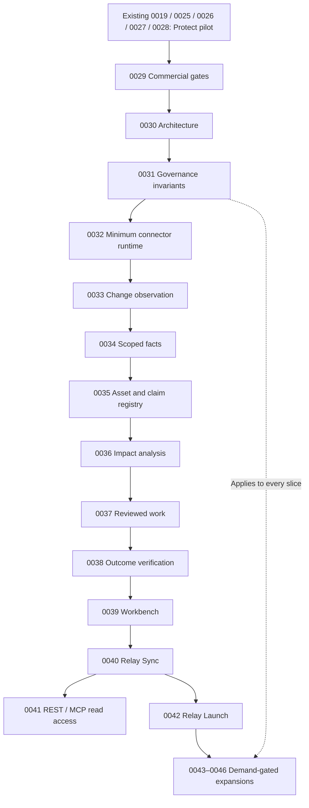

# Relay RFCs 0029–0046 — implementation order

> **Canonical execution queue:** [IRFC-0001–0032](implementation/README.md). This historical 0029–0046 index remains available for design dependencies; use the new sequential IRFC numbers for implementation.

**Reordered:** October 27, 2026  
**Repository:** [`PlaybookMediaLLC/relay`](https://github.com/PlaybookMediaLLC/relay), default branch `develop`  
**Status:** Proposed design RFCs; **not** implemented, merged, deployed, or commercially validated.  
**Numbering rule:** Existing RFCs **0001–0028 are unchanged**. Only the new 18-file proposal was renumbered. See [old-to-new mapping](PRODUCT-REALITY-RFC-RENUMBERING-MAP.md).

## Implementation decision

**Start with the proposed Protect pilot (RFC-0026) and production-repair work.** RFC-0026 governs commercial qualification and RFCs 0019, 0025, 0027, and 0028 cover actual release monitoring, safe corrections and production verification. Do not delay this revenue test while building a platform. The new numbering applies to the _additional_ Product Reality Engine and later products.

The numbered RFCs below follow **earliest useful implementation and dependency order**, not functional-category grouping. Cross-cutting contracts are written early but implemented incrementally, not fully up front. RFC-0029 is a commercial decision gate rather than a software dependency; RFC-0031 applies security and metering standards throughout instead of demanding its entire future feature set in the first PR.

## Numbered implementation backlog

| New RFC                                                                  | Scope                                             | Planned first use                 | Previous ID     |
| ------------------------------------------------------------------------ | ------------------------------------------------- | --------------------------------- | --------------- |
| [0029](0029-commercial-pilots-rollout-and-go-no-go.md)                   | Commercial gates and product sequencing           | Gate 0; then each product         | Former RFC-0046 |
| [0030](0030-product-reality-engine-architecture.md)                      | Product Reality Engine architecture               | Foundation                        | Former RFC-0029 |
| [0031](0031-platform-governance-privacy-metering-and-service-quality.md) | Security, tenancy and operating constraints       | Foundation, cross-cutting         | Former RFC-0045 |
| [0032](0032-connector-runtime-permissions-and-health.md)                 | Connector contracts and health                    | Foundation / as needed            | Former RFC-0036 |
| [0033](0033-change-observation-and-provenance.md)                        | Replayable source and change observations         | Sync foundation                   | Former RFC-0030 |
| [0034](0034-versioned-product-facts-and-authority.md)                    | Versioned product facts and source authority      | Sync foundation                   | Former RFC-0031 |
| [0035](0035-customer-facing-assets-and-claims.md)                        | Customer-facing assets and extracted claims       | Sync foundation                   | Former RFC-0032 |
| [0036](0036-impact-analysis-and-dependency-graph.md)                     | Deterministic impact analysis                     | Sync foundation                   | Former RFC-0033 |
| [0037](0037-work-plans-authorization-and-execution.md)                   | Work plans, exact approval and execution          | Sync correction                   | Former RFC-0034 |
| [0038](0038-verification-outcomes-and-learning.md)                       | Independent verification and outcomes             | Sync correction                   | Former RFC-0035 |
| [0039](0039-product-workbench-ux-and-human-review.md)                    | Reviewer workbench and source evidence            | Minimum UI with each slice        | Former RFC-0043 |
| [0040](0040-relay-sync-product-truth-and-content-integrity.md)           | Relay Sync: commercially valuable accuracy checks | First adjacent paid product       | Former RFC-0038 |
| [0041](0041-versioned-api-mcp-and-event-subscriptions.md)                | Versioned API and MCP access                      | With paying integration demand    | Former RFC-0044 |
| [0042](0042-relay-launch-change-to-commercial-release.md)                | Relay Launch: coordinated releases                | After Sync validation             | Former RFC-0039 |
| [0043](0043-relay-protect-journey-and-release-assurance.md)              | Protect journey monitoring expansion              | After baseline Protect validation | Former RFC-0037 |
| [0044](0044-conversion-revenue-and-attribution-integrity.md)             | Conversion and revenue integrity                  | After journey demand              | Former RFC-0040 |
| [0045](0045-activation-support-and-experience-signals.md)                | Activation and support signals                    | Later                             | Former RFC-0041 |
| [0046](0046-enablement-integrations-and-partner-assets.md)               | Sales and partner content integrity               | Later                             | Former RFC-0042 |

The series contains 18 RFCs, with an early Sync foundation and deliberately deferred product expansions. **Later RFC numbers are not delivery dates or approval to ship customer-facing automations.**

## Precise build sequence

| Sequence / incremental deliverable                  | Work to implement                                                                                                               | Producer dependencies                                              | Acceptance gate                                                                                          |
| --------------------------------------------------- | ------------------------------------------------------------------------------------------------------------------------------- | ------------------------------------------------------------------ | -------------------------------------------------------------------------------------------------------- |
| **0 — Sell original Protect**                       | Existing RFC-0026 phase A and RFC-0019/0025/0027/0028, plus new 0029 commercial review                                          | Existing repository, real buyer and explicit site scope            | Paid restricted pilots, approved repairs and real production proof where available                       |
| **1 — Make one source observation auditable**       | 0030 architecture subset; 0031 project scope, privacy and limits; 0032 minimal connector record; 0033 manual/GitHub observation | Existing 0005, 0008, 0009 auth/job/publishing seams                | One re-playable scoped source event; an observed commit is not claimed as a deployment                   |
| **2 — Know one fact and one customer-facing claim** | 0034 scoped fact versions; 0035 selected Git-backed assets and exact claims                                                     | 0033 observation + 0017 docs index and supported file reading      | Versioned fact authority and exact citations; no false contradiction for grandfathered cohorts           |
| **3 — Explain the effect**                          | 0036 limited deterministic fact/claim impact matching                                                                           | 0034 + 0035                                                        | Confirmed conflict only when scope/effective dates and evidence are sufficient; unknown is review-needed |
| **4 — Prepare and verify one correction**           | 0037 narrowly scoped work/authorization; 0038 independent verification                                                          | Existing 0005/0027/0028 safety; 0036 confirmed impact              | An exact reviewed PR, customer's merge and post-deployment evidence; no fake GSC opportunity             |
| **5 — Make review understandable**                  | 0039 minimum read-only and approval UI using existing work and publishing components                                            | Implement alongside 0033, 0037 and 0038 as their data appears      | Source, diff, owner, risk, pending approval and production status are distinguishable                    |
| **6 — Sell Relay Sync**                             | 0040 scoped plan/feature/integration truth and content-integrity workflow                                                       | Slices 1–5 and buyer evidence under 0029                           | One paid customer-recognized discrepancy corrected and independently verified; renewal hypothesis tested |
| **7 — Expose safe developer access**                | 0041 read-only REST/MCP interfaces, optional signed event delivery                                                              | Stable data contracts from 0033–0040; existing MCP auth            | Project scoped, paginated, bounded, no implicit approval or external writes                              |
| **8 — Sell Relay Launch**                           | 0042 manual fact-backed launch packet; reuse existing 0023 page checklist                                                       | Accepted facts, impacts and reviewed work from Sync; existing 0023 | Real customer release creates, reviews and publishes a coordinated, traceable packet                     |
| **9 — Expand only on evidence**                     | 0043 protected journeys → 0044 conversion/revenue integrity → 0045 activation/support → 0046 sales/partner accuracy             | Prior validation and each RFC's feature-specific prerequisites     | Actual buyer demand, controlled permissions and repeat paid use, not feature completeness                |

### Architecture dependency map

The diagram is a **default delivery path**, not a demand that a whole service be finished before a consumer uses its first safe, read-only capability. For example, the workbench's minimal read-only view belongs with initial observations; full approval UI lands with 0037. Launch does not strictly depend on the external API. Protect journey checks (0043) may move ahead of Launch when a paying Protect customer has a demonstrable need; their numeric placement reflects default priority, not a permanent product freeze.

## Existing engineering work that remains authoritative

| Existing RFC                                  | Requirement for new series                                                                                              |
| --------------------------------------------- | ----------------------------------------------------------------------------------------------------------------------- |
| **0005** GitHub publishing                    | Preserve immutable source fingerprints, precise approvals, PR recovery and customer-owned merges.                       |
| **0008** Growth jobs                          | Reuse existing worker job scheduling and retries; never invent freshness guarantees.                                    |
| **0009** Spend, audit and credential controls | Preserve project authority, metering and audit trail; new actions must pass the same checks.                            |
| **0016/0017** Revenue and docs                | Reuse limited Stripe/GA4 attribution and Git-backed docs indexing/editing. Do not broaden source access without review. |
| **0018** This Week                            | Extend existing work view; it does not imply standing approval authority.                                               |
| **0019/0025–0028** Protect workflow           | Actual monitoring, proposal-bound previews and production verification are still independently gated.                   |
| **0021** Verified business facts              | Avoid creating a second conflicting authority registry; its proposed simpler fact model must bridge to 0034.            |
| **0023** Launch checks                        | Its existing-page technical checklist feeds 0042; do not make automatic page generation a prerequisite.                 |
| **0024** Page history                         | Share verified change history and cooldown rules. No unsupported attribution claims.                                    |

## Review, implementation and publication rules

- Keep the original RFC 0001–0028 names and IDs. This pack adds only RFC 0029–0046 and non-numbered companion files.
- Do not implement all tables, adapters, partner writes, or LLM-based planners ahead of one paid validated workflow.
- Follow the repository's `AGENTS.md`: TanStack server function → service → repository, Zod validation, correct project/organization authorization and dual SQLite/PostgreSQL schema/migrations with real-SQL tests.
- Preserve independent evidence for **committed**, **deployed**, **available**, **approved**, **published**, **technically verified** and **commercially measured** states.
- Untrusted provider data never becomes instructions or permissions. No silent automatic merges, live purchases, billing mutations, customer emails or CRM writes.
- Observe costs, retention, provider failures, revoked permissions and incomplete/unknown states. Explicitly disclose insufficient data.
- Update the repository's existing RFC README with a link to this index in a **separate reviewed PR**. No edits to current repo files have been performed by this package generation.

[Implementation handoff](PRODUCT-REALITY-IMPLEMENTATION-HANDOFF.md) · [Reference acceptance flow](PRODUCT-REALITY-REFERENCE-FLOW.md) · [Numbering map](PRODUCT-REALITY-RFC-RENUMBERING-MAP.md)
