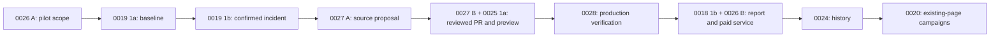

# Relay RFC delivery plan

**Updated:** October 23, 2026

**Strategy:** [Company](../../../company.md) · [Vision](../../../vision.md)

**Evidence:** [Current codebase audit](../relay-release-assurance-audit.md), baseline `0f09f36a`

The north star is accountable organic growth work: identify what matters, prepare an approved change, verify what happened in production, measure what can be measured, and retain the context. **The initial commercial product is release assurance for GitHub-managed Next.js marketing sites.**

This plan replaces the earlier “retention core” release order. Start with a bounded paid pilot, confirmed production regressions, and human-reviewed repairs. Broader campaigns, content creation, portfolio management, and delegated execution follow repeat paid demand. Research tools and existing integrations remain useful foundations.

RFC IDs and filenames remain stable because code, PRs, and design records already reference them. **Delivery order is the sequence below, not numeric order.** Existing closure and acceptance history is preserved. “Done” in an older RFC may mean its code scope was closed with explicit follow-ups; it does not prove a complete paid customer workflow.

## Ordered delivery backlog

Stages are gates, not promises of dates. Commercial discovery can run alongside implementation. A later consumer is not a prerequisite for its producer: monitoring does not wait for the weekly report, previews do not wait for autonomy, and facts do not wait for generated pages.

| Order | Smallest useful increment                                                           | RFC / prerequisites                                                                                                                     | Exit evidence                                                                                                                                        |
| ----- | ----------------------------------------------------------------------------------- | --------------------------------------------------------------------------------------------------------------------------------------- | ---------------------------------------------------------------------------------------------------------------------------------------------------- |
| 1     | Qualify the buyer, agree scope/price, name a reviewer, and record readiness         | [0026 phase A](0026-protected-site-pilots-and-service.md); recheck relevant 0001/0007/0009 follow-ups                                   | Three paid restricted pilots targeted; actual commitments/payments distinguished. Assisted work disclosed.                                           |
| 2     | Protected-page scope, durable snapshots, known-good baseline, schedule health       | [0019 phase 1a](0019-release-monitoring-and-regression-repair.md); reuse 0005/0008/0009/0010/0015                                       | Owner can see what is protected, baseline provenance, and last/next successful checks.                                                               |
| 3     | Confirm and deduplicate production regressions; show cause evidence and tickets     | [0019 phase 1b](0019-release-monitoring-and-regression-repair.md); order 2                                                              | Controlled staging failures detected, transient/unknown states distinguished, quiet periods reviewed, lost coverage visible. No repair prerequisite. |
| 4     | Prepare source-proven title/description repairs from incident evidence              | [0027 phase A](0027-source-mapped-regression-repairs.md); order 3 and existing publisher                                                | Read-only exact proposal or useful unsupported ticket; no fake GSC opportunity; templated titles restored correctly.                                 |
| 5     | Execute an explicitly approved PR and check the customer's preview for that commit  | [0027 phase B](0027-source-mapped-regression-repairs.md) + [0025 phase 1a](0025-preview-sandboxes-on-cloudflare.md); order 4            | Authorized write → exact head SHA → build/rule evidence. Failed/missing/stale preview remains explicit. Customer decides merge.                      |
| 6     | Verify deployment and rerun the original production rule                            | [0028](0028-production-repair-verification.md); orders 3–5; completes 0019 phase 1c                                                     | Two production-verified customer repairs across separate organizations targeted under 0026; staged mechanics and real value evidence kept separate.  |
| 7     | Complete the weekly protection/work report and validate recurring service economics | [0018 phase 1b](0018-weekly-execution-queue.md) + [0026 phase B](0026-protected-site-pilots-and-service.md); order 6                    | Four-week coverage/repair/cost record, payment and renewals where due; target 8–10 paying sites in the 90-day validation program.                    |
| 8     | Persistent page history, shared cooldown/no-repeat enforcement, and draft context   | [0024 phases 1a–1b](0024-change-history-and-learning.md); existing records, orders 3/6, paid-service evidence                           | Reuse existing weekly filters; record verified repairs and accepted customer changes, enforce rules beyond selection.                                |
| 9     | Bounded existing-page snippet/link campaigns and decay recovery planning            | [0020 phase 1](0020-growth-campaigns-and-decay-recovery.md); order 8, existing detectors/edits, checks and verification                 | Useful approved campaign work or honest idle weeks; customer-reviewed decay precision and supported edit checks.                                     |
| 10    | Verified facts for grounded refreshes, then richer existing-page campaigns          | [0021 phase 0](0021-new-pages-from-verified-facts.md) → [0020 phase 2](0020-growth-campaigns-and-decay-recovery.md); order 9 and demand | Facts have sources/review/expiry; refreshes have no unsupported claims; data sufficiency and consent retained.                                       |
| 11    | Launch checks for existing customer-created pages                                   | [0023 phase 1](0023-launch-workflows.md); orders 3/6/9, not generated pages                                                             | Existing page gets a checked launch lifecycle with explicit indexing/measurement states.                                                             |
| 12    | Individually reviewed new pages from verified facts                                 | [0021 phases 1–2](0021-new-pages-from-verified-facts.md); orders 10–11, supported preview/publisher                                     | One useful page at a time, sourced claims, preview and launch checks, customer approval, and observed outcomes.                                      |
| 13    | Competitor response, track records, and portfolio expansion                         | [0022](0022-competitor-change-response.md), [0024 phase 2](0024-change-history-and-learning.md), [0007](0007-portfolio-operations.md)   | Explicit customer demand and each RFC's entry/data/tenancy gates. These can proceed independently once their actual dependencies are met.            |

The first paid service is orders 1–7. A detection-and-ticket pilot can operate after order 3 with its limits disclosed. The source proposal, preview, and verification contracts should be reviewed together, but their increments ship in orders 4–6.

### Optional later tracks

- **More repair classes:** RFC-0019 phase 2 reuses existing canonical/robots adapters only after source mapping, preview, and production-verification acceptance for each class. Rendered/performance monitoring needs measured demand and cost.
- **Delegated execution:** RFC-0018 phases 2–3 are deferred until order 7's paid/reliability evidence and order 8's history rules pass. Require scoped revocable owner policies, current exact-change checks, and customer branch protections. They do not gate the initial service.
- **Relay-owned preview builds:** RFC-0025 phase 0 is a later go/no-go spike; phases 1b/2 require proven isolation, teardown, affordable costs, and customer need. Customer previews in order 5 ship without this infrastructure.
- **Existing broader features:** Validate RFC-0011 split tests, RFC-0012 conversion, RFC-0013 accessibility, RFC-0014 performance, RFC-0016 revenue, and RFC-0017 support/docs when demanded and eligible. Reuse shipped code; do not make every deferred connector or live test a global pilot blocker.

## Critical dependency path

Existing implemented foundations support each node. The arrows do not reopen all historical RFC scopes or require every optional feature to ship.

## Complete inventory and audited status

**Implemented** means source exists for the recorded scope. **Partial** identifies reusable code plus an unbuilt contract. **Draft/Proposed** means planned work. **Deferred** is a prioritization decision. Live acceptance must cite its site, date, scope, and evidence separately. No entry here asserts commercial validation.

| RFC                                                                             | Audited status / next action                                                                      | Delivery role                                              |
| ------------------------------------------------------------------------------- | ------------------------------------------------------------------------------------------------- | ---------------------------------------------------------- |
| [0001 Launch readiness](0001-launch-readiness.md)                               | Historical code/configuration closure; external/live follow-ups remain                            | Recheck relevant readiness per pilot in order 1.           |
| [0002 Opportunity detectors](0002-opportunity-detectors.md)                     | Implemented; search-data/paid acceptance follow-ups                                               | Reuse signals; later campaigns.                            |
| [0003 Opportunity queue](0003-opportunity-queue.md)                             | Implemented; real-team acceptance follow-ups                                                      | Review, ownership, defer, tickets.                         |
| [0004 AI SEO engineer](0004-ai-seo-engineer.md)                                 | Implemented; live/owner-rated draft acceptance follow-ups                                         | Investigation and supported drafts.                        |
| [0005 GitHub execution](0005-github-execution.md)                               | Implemented; historical S1/lab acceptance recorded, scoped follow-up remains                      | Reuse publisher; extend incident evidence in 0027.         |
| [0006 Outcome measurement](0006-outcome-measurement.md)                         | Implemented; GA4/GSC/live acceptance follow-ups                                                   | Optional observations after technical verification.        |
| [0007 Portfolio operations](0007-portfolio-operations.md)                       | Isolation implemented; portfolio product deferred                                                 | Isolation now; portfolio only after entry gate.            |
| [0008 Scheduling and notifications](0008-growth-automation.md)                  | Implemented with Worker cron; multi-day acceptance pending in historical notes                    | Reuse runner; prove monitoring cadence.                    |
| [0009 Spend limits and audit log](0009-spend-limits-and-audit-log.md)           | Implemented; historical live check, staging/key follow-ups                                        | Controls throughout.                                       |
| [0010 SEO checks in CI](0010-seo-checks-in-ci.md)                               | Implemented; smoke/render checks recorded, installation/acceptance follow-ups                     | Prevention, distribution, reusable rules.                  |
| [0011 Page-group split tests](0011-page-group-split-tests.md)                   | Implemented scope; eligible real-group acceptance pending                                         | Optional later causal-test design, when eligible.          |
| [0012 Conversion optimization](0012-conversion-optimization.md)                 | Implemented phases 1–2; live acceptance and visitor tests pending                                 | Optional metrics now; richer campaigns later.              |
| [0013 Accessibility fixes](0013-accessibility-fixes.md)                         | Implemented; real-site/price-hold follow-ups                                                      | Supported specialized expansion.                           |
| [0014 Web performance](0014-web-performance.md)                                 | Implemented scope; CrUX/configuration/live follow-ups                                             | Supported specialized expansion.                           |
| [0015 Release quality gate](0015-release-quality-gate.md)                       | Implemented existing packs; performance pack and plan deferred                                    | Reuse existing checks for pilots.                          |
| [0016 Revenue attribution](0016-revenue-attribution.md)                         | Implemented Stripe scope; legal/setup/live follow-ups; other providers deferred                   | Optional evidence, never prerequisite or causal claim.     |
| [0017 Docs and support](0017-docs-and-support-deflection.md)                    | Implemented scope; support/legal/live follow-ups and connectors deferred                          | Reuse Markdown edits; expand on demand.                    |
| [0018 Weekly work/report](0018-weekly-execution-queue.md)                       | Partial: view, history, filters, report, digest built; protection integration and policies absent | Order 7; policies later.                                   |
| [0019 Monitoring/regressions](0019-release-monitoring-and-regression-repair.md) | Draft: durable baseline/monitor/incident model absent                                             | Orders 2–3; reviewed repair integration after 6.           |
| [0020 Campaigns/decay](0020-growth-campaigns-and-decay-recovery.md)             | Draft: orchestration and new recovery lifecycle absent                                            | Orders 9–10.                                               |
| [0021 Facts/new pages](0021-new-pages-from-verified-facts.md)                   | Draft; facts split into independent phase 0                                                       | Order 10 facts; order 12 new pages.                        |
| [0022 Competitor response](0022-competitor-change-response.md)                  | Draft; existing rank tracking is reusable                                                         | Order 13, demand-driven.                                   |
| [0023 Launch workflows](0023-launch-workflows.md)                               | Draft; existing-page checks precede generation                                                    | Order 11.                                                  |
| [0024 History/learning](0024-change-history-and-learning.md)                    | Partial selection rules exist; persistent history and draft memory absent                         | Order 8 before campaigns; track records later.             |
| [0025 Preview orchestration](0025-preview-sandboxes-on-cloudflare.md)           | Draft; supplied-preview checks exist, proposal orchestration absent                               | Order 5 customer previews; owned builds later.             |
| [0026 Protected-site service](0026-protected-site-pilots-and-service.md)        | New proposal                                                                                      | Orders 1 and 7; commercial and operational gates.          |
| [0027 Source-mapped repairs](0027-source-mapped-regression-repairs.md)          | New proposal                                                                                      | Orders 4–5; independent incident evidence.                 |
| [0028 Production verification](0028-production-repair-verification.md)          | New proposal                                                                                      | Order 6; original-rule resolution and measurement handoff. |

The earlier [organic growth audit](../organic-growth-audit.md) and [handoff](../organic-growth-handoff.md) remain historical context. Use the [October 23 audit](../relay-release-assurance-audit.md) for this ordering. Design records for completed scopes remain under [specs](../specs/), including [approved GitHub metadata](../specs/approved-github-metadata.md) and [search outcome measurement](../specs/search-outcome-measurement.md).

## Delivery rules

1. Reuse working integrations and services; retain upstream attribution and fork seams. Keep application-backed changes on the server function → service → repository path, with Zod boundaries and organization/project authorization.
2. Keep relational data explicit and every schema change compatible with SQLite/D1 and Postgres. Preserve existing opportunity approval behavior while adding incident evidence.
3. Human exact-change approval precedes customer-repository writes in the initial service. Customer CI, branch protection, merge, deployment, and rollback remain in force. Later standing policies are proposals, not current authorization.
4. Treat crawled pages, repository files, and provider output as untrusted data. Bound fetches, storage, retries, optional provider spend, and untrusted build execution.
5. Distinguish proposed, approved, PR-open, merged, deployed, technically verified, and measured states. An unknown check or missing analytics is never a pass or zero impact.
6. Apply the relevant existing RFC follow-ups at activation. A closed historical code scope does not waive external credentials, consent, live acceptance, or customer authority.
7. Run the required implementation checks below before a code merge. For documentation-only changes, validate formatting, links, inventory coverage, dependency consistency, and the accuracy of code claims; do not imply a live test occurred.
8. Record implemented scope, live-acceptance evidence, and commercial evidence separately. A local test or owned staging site cannot prove willingness to pay or renewal.

## Real-site test sites

Each delivery slice needs authorized real-site acceptance in addition to fixtures. The site descriptions below are historical context from the existing RFCs; recheck access, stack, and ownership before use. Seed regressions only on authorized staging/test sites. Production observation is passive unless a customer separately approves a real repair.

| ID  | Site                     | Stack and repository                                                                                                                                                                                                                                                                                                                                                         | Use it for                                                                                                               |
| --- | ------------------------ | ---------------------------------------------------------------------------------------------------------------------------------------------------------------------------------------------------------------------------------------------------------------------------------------------------------------------------------------------------------------------------- | ------------------------------------------------------------------------------------------------------------------------ |
| S1  | `playbookmedia.io`       | Next.js 16 App Router on Cloudflare (OpenNext). `PlaybookMediaLLC/monorepo`, root `apps/www`. Pages sit in the `(site)` route group and call `pageMetadata(title, description, path)`. The root layout sets a title template. GitHub deployments use the environment `production`. A staging copy runs at `www-staging.yoanyomba.workers.dev`.                               | Publishing, drafting, deployment signals, reverts, measurement plumbing.                                                 |
| S2  | `conduitt.io`            | Next.js marketing site. Confirm the repository before the test.                                                                                                                                                                                                                                                                                                              | Detection, drafting and measurement, when it meets the data floor.                                                       |
| S3  | `relay.playbookmedia.io` | TanStack Start, not Next.js. `PlaybookMediaLLC/open-seo`. Search Console verified on 2026-10-15.                                                                                                                                                                                                                                                                             | Detection on a new site, site audits, automation, honest "not enough data" results, refusal of an unsupported framework. |
| S4  | `solomonhq.io`           | Next.js App Router on Cloudflare (OpenNext), with route groups and 4 dynamic segments (`[product]`, `[industry]`, `[program]`, `[segment]`) that make 24 of its 36 sitemap URLs. `Oppulence-Engineering/oppulence-canvas`, root `apps/solomon-ai-marketing`. Relay project created on 2026-10-16. The first audit found 3 pages without an H1 and `llms.txt` in the sitemap. | Clean refusal of dynamic routes, and the file locator on a larger site.                                                  |

Do not use these as test sites:

- `eigenn.io`: the home page is a sign-in screen.
- `cadense.io`: it returns a bot challenge to non-browser clients. Check separately that Googlebot can crawl it.

**Data floor.** Search-opportunity value tests retain the existing target of at least 5,000 impressions and 100 clicks in the last 28 days; record the actual totals and use an owner-authorized partner site if necessary. Technical release protection and repair verification have **no traffic floor**: use seeded staging regressions and important low-traffic pages too. GA4, split-test, and revenue analyses retain their own eligibility and consent rules. Internal test sites cannot substitute for the cross-organization paid-customer evidence in RFC-0026.

## Value bar for every real-site test

A test passes only when all of these hold:

1. **Evidence.** Every item shows its observations, numbers when available, and source. A person can check the production snapshots, GitHub records, Search Console, or GA4 evidence in under two minutes. Technical findings do not require analytics data.
2. **Action.** Every item offers one concrete next step.
3. **Honesty.** When data is missing or too thin, Relay says so and invents nothing.
4. **Speed.** A person who knows the site goes from opening an item to an approved change or a ticket in under 10 minutes.
5. **Differentiation.** At least one result could not come from a plain Search Console report. It combines sources, prepares a change, or measures an outcome.
6. **Record.** Put the results, numbers and screenshots in the PR description. Add "Accepted on {site}, {date}, PR #{n}" to the RFC's status line.

## Definition of done for every phase

These requirements apply to an implementation phase alongside its own acceptance criteria; this documentation update does not claim to have completed them. Mark code as implemented separately from live acceptance and commercial validation. Record an explicit, justified non-applicable item instead of silently treating it as passed.

**Code and checks**

1. `pnpm types:check`, `pnpm lint`, `pnpm exec knip`, `pnpm exec prettier --check .`, `pnpm test:ci` and `pnpm vite build` pass.
2. Every new `// playbook-seam` line is listed in the seam registry comment in `vite-plugin-relay-brand.ts`.
3. Each new rule has a test at each threshold boundary: just below, at, and just above.
4. The RFC-0007 tenancy suite covers every new service read and write.

**Data**

1. Migrations apply cleanly to a fresh D1 database, to a copy of the production D1 database, and to the Postgres test cluster.
2. Every migration is forward-only and additive, or the PR states the backfill and the rollback plan.

**Quality in production**

1. The deploy smoke test passes.
2. Monitoring shows no new unhandled error for 72 hours after the deploy.
3. New read endpoints answer in under 500 ms at the 95th percentile on production data.
4. New screens show first content in under 1.5 seconds on a desktop connection.
5. No paid provider call sits on a page-load path.

**Security**

1. Every input is validated with Zod at the server boundary.
2. Every service call checks the organization and the needed permission.
3. A search of the production logs for the phase's test period finds no token, secret or provider response body.
4. A second person reviews the security notes of the RFC against the code.

**Usability**

1. An automated accessibility check (axe) finds no serious or critical violation on new screens.
2. Every new control works with the keyboard alone and has a label.
3. New screens work at 390 px and 1440 px wide.
4. Every empty, loading and error state has plain text that says what happened and what to do next.

**Documentation**

1. A user page in `content/docs/` explains the feature, its limits and its cost.
2. A design record in `docs/maintainers/specs/` explains what the feature does and why. It follows the specs rules in `AGENTS.md`.

**Evidence**

1. The real-site acceptance test passed. The PR description holds the numbers, screenshots and links.
2. The RFC status line says "Accepted on {site}, {date}, PR #{n}".
