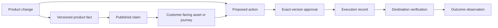

# Relay — vision and path to the north star

**Updated:** October 25, 2026

**Relay keeps everything a SaaS business promises, publishes, and delivers aligned as its product changes.**

The long-term direction is the operating system for SaaS customer-facing operations: understand what changed, identify the affected customers and systems, coordinate approved work, verify completion, and retain the evidence for the next decision.

Website release assurance is the first commercial entry point, under **Relay Protect**. **Relay Sync** extends into product-information integrity. **Relay Launch** coordinates the commercial work created by releases. SEO remains a valuable acquisition capability throughout. The buyer, price hypotheses, and paid-validation program are in [company.md](company.md).

This document describes the intended product and architecture. Planned capabilities and planning horizons are not shipped features or delivery commitments.

## The north-star experience

Whenever something changes, an owner can ask Relay:

1. What actually changed, and which evidence establishes it?
2. Which customers, pages, journeys, assets, and published claims are affected?
3. What needs to happen in each connected system, and who owns it?
4. Which exact actions are authorized, and which need a person's decision?
5. Did the work reach its destination, resolve the issue, and produce a measurable result?

The loop is **observe → establish facts → determine impact → prepare → approve → execute → verify → learn**. A quiet period, an unsupported action, conflicting evidence, and insufficient outcome data are explicit results.

The browser is the place to inspect evidence, review incidents, authorize work, and understand results. The core should be API-first and MCP-accessible so CI, agents, and existing team tools can use the same facts and permissions.

## The Product Reality Engine

Build one shared change lifecycle and evidence model. Each commercial workflow should become more useful because it understands the work and facts used by the others.

| Capability              | Responsibility                                                                                                           | Evidence and controls                                                                                                                 |
| ----------------------- | ------------------------------------------------------------------------------------------------------------------------ | ------------------------------------------------------------------------------------------------------------------------------------- |
| Observe changes         | Connect GitHub, deployments, feature flags, billing configuration, analytics, support, and website observations.         | Record source identity, version, observation time, tenant, and collection health. A missing signal is not proof that nothing changed. |
| Establish product facts | Describe features, plans, limits, integrations, APIs, availability, audiences, and effective dates.                      | Version evidence and source authority; preserve rollout segments, exceptions, and unresolved conflicts.                               |
| Determine impact        | Map facts and changes to pages, docs, offers, support answers, sales assets, onboarding, campaigns, and customer groups. | Keep source-to-claim links explicit. Distinguish a confirmed contradiction from a possible inconsistency.                             |
| Prepare and execute     | Draft supported PRs, content edits, corrected assets, launch tasks, or workflow repairs.                                 | Bind approval to the exact action and version; revalidate source state and authority before execution.                                |
| Verify and learn        | Check production behavior, published claims, delivery receipts, adoption, conversions, and prior decisions.              | Separate publication, technical resolution, and commercial outcome. Retain failed work and inconclusive results.                      |

### Connected records

The planned model connects:

These are domain concepts to design, not a claim that new database tables already exist. Reuse existing approvals, proposals, deployment signals, and measurement records where they satisfy the contract.

A **ProductFact** may establish that an integration is available on the Business plan, in the US, after a particular rollout date. A **PublishedClaim** may identify a page that promises it to everyone. That is a confirmed contradiction only when the authoritative evidence, audience, time, and claim meaning are comparable. Ambiguous wording, stale evidence, or an unknown rollout segment needs review.

Facts need an authority policy and provenance, not just an embedding or an LLM summary. A source commit establishes intent; production observations establish observed behavior. Neither alone proves availability for every customer. Grandfathered plans and regional or staged rollouts remain first-class constraints.

### One pricing change, connected work

A hypothetical new pricing model can require:

| System                  | Required work                                                                                       |
| ----------------------- | --------------------------------------------------------------------------------------------------- |
| Billing                 | Compare configured prices and entitlements with the approved policy.                                |
| Website                 | Find stale plan references on pricing, product, landing, and comparison pages.                      |
| Documentation           | Update limits, upgrade instructions, FAQs, and examples.                                            |
| Sales and support       | Prepare revised briefs, feature matrices, and saved replies.                                        |
| Onboarding              | Find tutorials and upgrade messages that still describe old plans.                                  |
| Customer communications | Prepare notices for the authorized, affected groups, respecting grandfathered accounts.             |
| Acquisition             | Check advertising destinations, search snippets, and observable AI-search answers for stale claims. |
| Conversion              | Test the advertised purchase path through a safe, agreed journey.                                   |
| Verification            | Confirm each approved correction is live and report unresolved work.                                |

All actions share one change identity and one approved set of facts. Observing an external search answer does not imply Relay can directly edit it.

## Commercial sequence

Sell three understandable workflows first:

- **Protect:** Keep revenue-critical website surfaces and supported customer journeys working.
- **Sync:** Keep what customers are told consistent with verified product capabilities.
- **Launch:** Turn meaningful releases into coordinated commercial launches.

A hypothetical integration release should become one launch operation. Relay establishes capability, permissions, eligible plans, rollout, and affected users; then prepares integration-page updates, setup instructions, example checks, screenshots through **Shots**, a changelog, announcements, and sales materials. Authorized CRM or support data can identify customers who requested it. Publication evidence and activation instrumentation belong to that same release.

Each destination has its own approval and verification contract. Generating a launch packet is not equivalent to publishing it, delivering a message, or proving customer adoption.

## Longer-term capability map

These are possible product areas built on the common engine, not twelve independently scheduled products or currently available modules.

| Area          | Work Relay could own                                                                                                             | Customer value                                                                    |
| ------------- | -------------------------------------------------------------------------------------------------------------------------------- | --------------------------------------------------------------------------------- |
| **Guard**     | Production page and journey checks, tracking, metadata, redirects, accessibility, reproducible incidents, and supported repairs. | Prevent lost leads and failed purchases.                                          |
| **Truth**     | Reconcile pricing, entitlements, features, screenshots, integration claims, and docs.                                            | Reduce inaccurate promises.                                                       |
| **Launch**    | Coordinate release notes, pages, announcements, product imagery, and sales briefs.                                               | Make shipped capabilities commercially usable.                                    |
| **Docs**      | Maintain guides and API instructions, address support-driven gaps, and verify published answers.                                 | Reduce repeated support and broken instructions.                                  |
| **Growth**    | Research demand, improve pages, repair technical SEO, monitor AI citations, and measure organic acquisition.                     | Create qualified demand from existing capabilities.                               |
| **Convert**   | Find broken forms and journeys, prepare landing-page improvements, run experiments, and verify tracking to CRM or purchase.      | Improve qualified conversion.                                                     |
| **Activate**  | Align onboarding, tours, tutorials, and lifecycle messages with deployed features.                                               | Help customers reach their first useful result.                                   |
| **Enable**    | Maintain briefs, feature matrices, demo assets, objection responses, and account-specific updates.                               | Give sales and customer success current information.                              |
| **Ecosystem** | Track APIs and SDKs, verify integration instructions, and maintain partner listings.                                             | Reduce integration failures and missed partner demand.                            |
| **Revenue**   | Compare pricing, billing configuration, and entitlements; check purchase paths and revenue-event delivery.                       | Find inconsistent plans, checkout failures, and reporting errors.                 |
| **Trust**     | Check accessibility, security claims, policy references, status links, and certification evidence.                               | Identify stale or unsupported customer-facing claims; do not imply certification. |
| **Learn**     | Connect authorized support, usage, reviews, and feedback to recurring problems and verified corrective work.                     | Turn complaints into improvements that reach customers.                           |

Protect initially draws on Guard; Sync draws on Truth and Docs; Launch consumes the same facts, assets, and verification services. Other areas expand only when a buyer pays for a repeatable workflow.

## Foundation and current gaps

The [October 23 codebase audit](docs/maintainers/relay-release-assurance-audit.md) records reusable foundations. Its implementation evidence is not acceptance of the broader platform.

| Foundation                                                  | Current position                             | Next extension                                                      |
| ----------------------------------------------------------- | -------------------------------------------- | ------------------------------------------------------------------- |
| SEO research, audits, backlinks, AI visibility              | Substantial implementation                   | Acquisition intelligence attached to business changes               |
| Search Console and GA4                                      | Existing integrations                        | Change-linked observations with honest data coverage                |
| Source access and reviewed GitHub proposals                 | Supported edits implemented                  | More evidence sources and explicitly supported change classes       |
| Documentation indexing and Markdown edits                   | Existing foundation                          | Product facts and published-claim verification                      |
| Experiments and revenue attribution                         | Existing code with acceptance requirements   | Outcome measurement for additional workflows                        |
| CI and supplied-preview checks                              | Existing checks                              | Bind checks to the exact proposed commit                            |
| Jobs, spending controls, notifications                      | Existing infrastructure                      | Reuse for recurring operational work                                |
| Durable production baselines and repair verification        | Still planned in the audited Protect roadmap | Common monitoring and verification services                         |
| Complete revenue-critical browser journeys                  | Not established as a complete product        | Build or integrate bounded, safe browser checks                     |
| Cross-system fact and impact model                          | New core work                                | Versioned authority, affected assets, and a shared change lifecycle |
| Multichannel publishing, CRM execution, adoption automation | Substantial new work                         | Add selective integrations after paid demand                        |

## Evidence-gated roadmap

These horizons are relative planning ranges, not dates or delivery promises. Each expansion depends on evidence from the preceding work.

| Horizon          | Main investment                                                                                                                                                 | Evidence required before expanding                                                                          |
| ---------------- | --------------------------------------------------------------------------------------------------------------------------------------------------------------- | ----------------------------------------------------------------------------------------------------------- |
| **0–3 months**   | Complete Protect: known-good baselines, consequential regressions, safe repairs, production verification, paid pilots, and technically feasible journey checks. | Paying customers, accepted fixes, low false-positive rates, visible coverage, and manageable service costs. |
| **3–6 months**   | First Product Reality Engine and Sync around pricing, plans, integration availability, docs, and marketing pages.                                               | Repeated verified inconsistencies that customers pay to resolve.                                            |
| **6–12 months**  | Launch: release interpretation, coordinated packets, docs, sales assets, authorized announcements, and destination verification.                                | Companies repeatedly run launches through Relay.                                                            |
| **12–18 months** | Expand Growth and Convert: content improvement, acquisition workflows, lead-flow checks, experiments, and attribution integrity.                                | Measurable outcomes with sufficient evidence, repeated use, and renewal.                                    |
| **18–30 months** | Activate, Enable, and Learn through adoption integrations, education, support-to-product work, and sales-content integrity.                                     | Regular use across departments, identifiable budget owners, and incremental revenue.                        |
| **30–60 months** | Portfolio and enterprise operations: governance, regional content, policy-controlled actions, partner ecosystems, and broad API access.                         | Proven enterprise demand, reliable controls, viable economics, and sustainable support capacity.            |

The [RFC delivery plan](docs/maintainers/rfcs/README.md) remains the detailed sequence for Protect: pilot scope → production baseline → confirmed incident → source proposal → reviewed PR and commit-bound preview → production verification → recurring service.

Existing history, facts, documentation, and launch RFCs provide reusable pieces. They do not already specify the full Product Reality Engine, Sync, or coordinated Launch product. Define those contracts as separate future increments before implementation. The previous SEO expansion backlog no longer determines the company's long-term priority.

## Product and engineering principles

**Preserve explicit authority.** The initial service requires a person to approve the exact repository change and merge it. Customer CI, branch protection, deployment, and rollback controls remain in force. Agents can investigate and draft within their permissions. Future standing approvals must be scoped, revocable, and revalidated; unrestricted autonomous publishing is outside the vision.

**Verify the destination.** Keep source, preview, deployment, live behavior, and outcome observations linked but distinct. A merge is not a production resolution. A delivery receipt is not proof that a customer read a message. Recheck the original failure or claim, not just a generic health endpoint.

**Keep repairs narrow.** Map observed behavior to supported source edits. Inherited title templates, metadata helpers, dynamic routes, headers, and rewrites need explicit handling or a ticket. Never paste a rendered title into source without understanding its transformation.

**Integrate established systems.** Consume analytics, billing, feature flags, CRM, help-desk, and adoption facts through authorized connections. Do not rebuild those products. Use Shots for visual production.

**Keep core records independent of SEO.** Relay is now outside OpenSEO's GitHub fork network. Retain MIT attribution and useful services, watch upstream security fixes, and review incoming changes. The sync workflow remains configured. Let the facts and change lifecycle drive boundaries when they require separation; avoid a premature platform rewrite.

**Protect tenants and bound execution.** Preserve tenant checks, dual SQLite/Postgres compatibility, spending controls, idempotent execution, and audit records. Every service states scope, cadence, limits, and support expectations. Revoked access, exhausted operational budgets, or stale checks must show lost coverage and a next step.

**Use the right evidence clock.** Technical verification follows publication or deployment. Adoption, search, conversion, and revenue measurement need sufficient observations over appropriate windows. Record positive, negative, and inconclusive results; descriptive changes are not automatically causal gains.

## Measuring the north star

The company metric to validate is **weekly paying businesses with verified coverage or completed customer-facing work**. Count each business once per week when it has an active paid scope and either:

- Its agreed monitoring ran successfully within cadence and its current coverage report is available; or
- A customer-authorized correction or launch action reached its destination and passed its defined verification.

A generated draft, open PR, enabled schedule, failed check, stale fact, or unverified publication does not qualify by itself. Report protected businesses and completed-work businesses separately alongside the deduplicated total. This is a proposed metric contract, not an existing dashboard claim.

During Protect validation, retain **weekly active protected paying websites** as the operational measure: each paying site has an agreed monitored set, successful checks within the promised cadence, and a current coverage/work report. Define events and exclusions in RFC-0026 before treating it as instrumented.

Pair these measures with verified resolutions, accepted claim corrections, repeated launches, alert precision, missed seeded regressions, time to completion, review burden, renewals, and gross margin. Quiet weeks qualify through observed coverage. An outcome report may honestly conclude that the data is insufficient.
